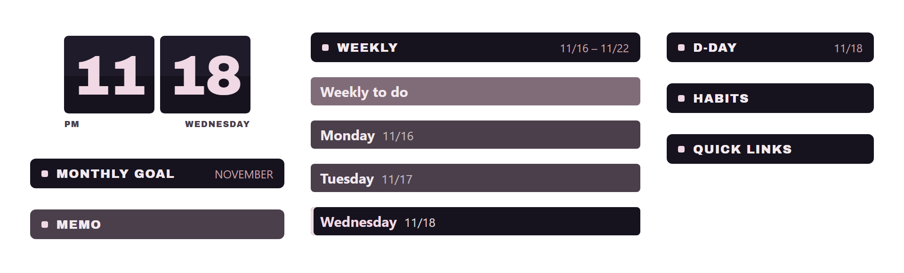

# notion-widgets

Small, quiet widgets to embed in Notion pages.
Notion 페이지에 넣어 쓰는 작은 위젯 모음이에요. 서버 없이 보는 사람의 브라우저 안에서만 동작해요.



## 위젯

| 위젯 | 주소 | 하는 일 |
|---|---|---|
| Flip clock | `https://broresult.github.io/notion-widgets/clock/` | 기기 시간을 보여 주는 플립시계 |
| Section label | `https://broresult.github.io/notion-widgets/label/?t=TITLE` | 섹션 제목 띠. 아래에 Notion 블록을 붙여 카드처럼 써요 |
| Day header | `https://broresult.github.io/notion-widgets/week/day.html?d=1` | 이번 주 요일 제목과 날짜. 매주 자동으로 바뀌어요 |
| This week | `https://broresult.github.io/notion-widgets/week/` | 이번 주(월–일) 날짜 범위와 주 번호 |
| Photo slot | `https://broresult.github.io/notion-widgets/icons/photo.svg` | 자기 사진으로 바꿔 넣는 자리 표시 이미지 |

## Notion에 넣는 법

1. Notion 페이지에서 `/embed`를 입력해요.
2. 위 주소를 붙여 넣고 `Embed link`를 눌러요.
3. 모서리를 끌어 크기를 맞춰요. 제목 띠와 요일 띠는 높이 약 40px이 알맞아요.

## 옵션

주소 뒤에 `?이름=값`으로 붙이고, 여러 개는 `&`로 이어요. 예: `.../clock/?h=24&tone=plum`

**모든 위젯 공통**

| 옵션 | 값 | 뜻 |
|---|---|---|
| `theme` | `light` / `dark` | 배경을 흰색이나 Notion 다크(#191919)로 고정. 없으면 기기 설정을 따라가요 |

**Flip clock**

| 옵션 | 값 | 뜻 |
|---|---|---|
| `h` | `24` | 24시간제 |
| `tone` | `soft` `mauve` `plum` `sage` `rose` `sky` | 타일 색. 없으면 회색 |

**Section label**

| 옵션 | 값 | 뜻 |
|---|---|---|
| `t` | 글자 (최대 40자) | 제목. 띄어쓰기는 `%20` |
| `info` | `month` / `date` / `week` | 오른쪽에 자동으로 바뀌는 이번 달, 오늘 날짜, 이번 주 범위 |
| `tone` | `soft` | 조금 밝은 플럼색 띠 |

**Day header**

| 옵션 | 값 | 뜻 |
|---|---|---|
| `d` | `0`–`7` | 1(월)부터 7(일)까지. `0`은 날짜 없는 "Weekly to do" 띠 |
| `tone` | `plum` / `mauve` | 한 가지 색 계열로 통일. 없으면 요일마다 다른 파스텔색 |

오늘 요일은 진하게 강조돼요.

**Photo slot**: `photo.svg`(회색), `photo-plum1.svg`–`photo-plum3.svg`(플럼). Notion에서 이미지를 눌러 `⋯ → 바꾸기`로 자기 사진을 넣어요.

## Privacy

- 외부 서버에 아무 요청도 보내지 않아요. 글꼴도 이 저장소 안에 있어요.
- 위치, 쿠키, 저장소(localStorage), 방문 통계를 쓰지 않아요.
- 모든 계산은 보는 사람의 브라우저 안에서만 일어나요.

## Development

빌드 도구 없이 순수 HTML, CSS, ES 모듈로 만들었어요.

```
npm test
```

## License

Code: MIT (see `LICENSE`).
Font: Archivo Black, SIL Open Font License 1.1 (see `fonts/OFL.txt`).
